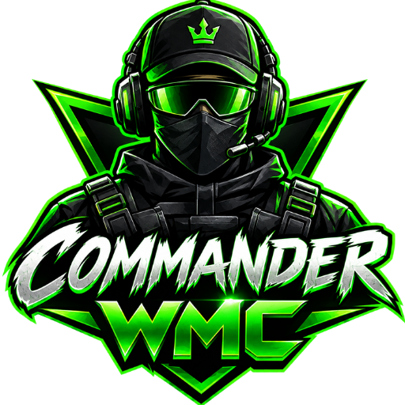

# CHAMI G | COMMANDER WMC - Official Gaming Portfolio

> Sri Lanka's Elite Tactical Gamer, Streamer, and Content Creator Command Hub.



---

## ⚡ Tech Stack & Architecture
- **Structure:** Semantic HTML5 (`index.html`)
- **Styling:** Modern CSS3 (`style.css`) with CSS Houdini `@property --gradient-angle`
- **Interactivity:** Pure JavaScript (`script.js`) with Web Audio API Synthesizer
- **Icons & Fonts:** FontAwesome 6, Google Fonts (`Orbitron`, `Rajdhani`, `Plus Jakarta Sans`)

---

## 🎮 Key Features

### 1. Synchronized Rotating RGB Stroke & Glowing Box Shadow
- Built using modern conic-gradient animation (`@property --gradient-angle` and `rotateRGB`).
- The outer border stroke and the blurred atmospheric box-shadow aura change RGB hues in complete unison.
- Mouse movement over cards triggers an interactive 3D perspective tilt effect.

### 2. Right-to-Left RGB Gradient Text Animation
- The header title (`CHAMI G` and `(COMMANDER WMC)`) features an animated multi-stop RGB gradient traveling continuously from **right to left**, visually harmonizing with the rotating border strokes.

### 3. Top Trending Gameplays & Clutches Showcase
- **Featured Live Stream:** Connected directly to the official Rust live broadcast (`https://youtube.com/live/JyKowdYaUu0?feature=share`).
- **Interactive Video Modal:** Click the Play button to watch the video directly on the website via an embedded player, or click "Open on YouTube" to visit the channel.
- **Supporting Game Showcases:** Featuring Rust clan raids, Dead by Daylight escapes, and Among Us imposter clutches.

### 4. VIP Access Authenticator & "Under Developing" Modal
- Clicking the **"AUTHENTICATE VIP ACCESS"** button activates a tactical cyber hologram popup displaying:
  - **Protocol Status:** `Under Developing`
  - Security Handshake Deployment progress bar (88%)
  - Direct CTA to join the Discord server or WhatsApp community for instant manual verification.

### 5. Tactical Comms & Social Hub
Direct links to all official platforms:
- **YouTube:** `https://www.youtube.com/@CHAMI_G`
- **Discord:** `https://discord.gg/z75kJZNZ2`
- **TikTok:** `https://www.tiktok.com/@chami_gaming2`
- **Twitch:** `https://www.twitch.tv/chami_stream`
- **Kick:** `https://kick.com/chami-g`
- **WhatsApp Hub:** `https://chat.whatsapp.com/DMUixfOP7IB9DxGkL2ND6v`
- **Facebook:** `https://www.facebook.com/share/15sKW15k7L`

### 6. Built-in Procedural Audio Synthesizer
- Uses the browser's native **Web Audio API** to generate futuristic cyber SFX for clicks, alerts, and confirmations without relying on external `.mp3` files.
- Includes an on-screen SFX toggle HUD button (`SFX: ON / OFF`).

---

## 📁 Project File Structure

```
YouTube Portfolio/
├── index.html        # Clean semantic structure with developer-friendly comments
├── style.css         # Organized in 15 distinct sections with design tokens
├── script.js         # Modular event handling, audio synthesis, and modal controllers
├── .gitignore        # Standard ignore rules
├── README.md         # Documentation & guide
└── assets/
    ├── commander_wmc_logo.png     # Official mascot & logo
    ├── rust_featured_yt.jpg       # Official YouTube live stream thumbnail
    ├── rust_raid_thumb.jpg        # Rust raid showcase thumbnail
    ├── dead_by_daylight_thumb.jpg # Dead by Daylight showcase thumbnail
    └── among_us_thumb.jpg         # Among Us showcase thumbnail
```

---

## 🚀 Running Locally

Simply open `index.html` in any modern web browser, or serve with:

```bash
# Using Python
python -m http.server 8080

# Or using npx
npx serve .
```

Visit `http://localhost:8080` in your browser.

---

## 🛡️ License & Copyright
© 2026 **CHAMI G / COMMANDER WMC**. All Rights Reserved.
